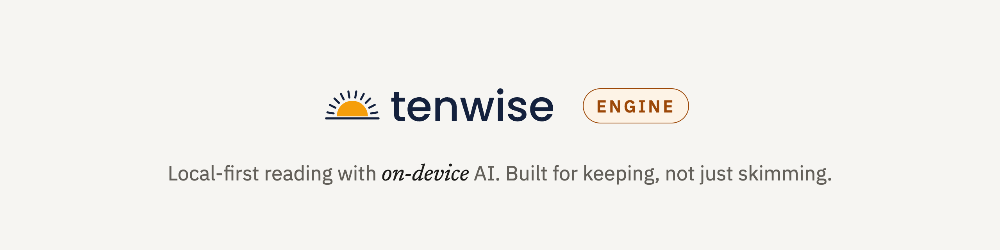
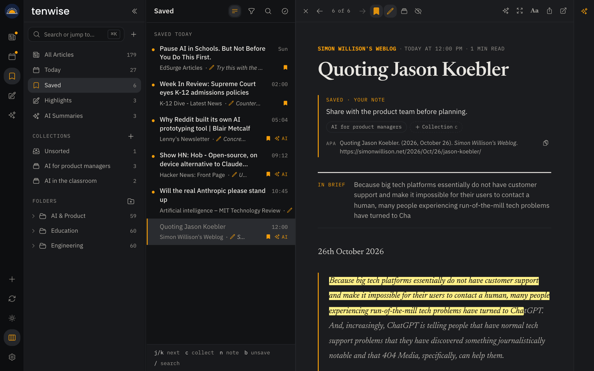
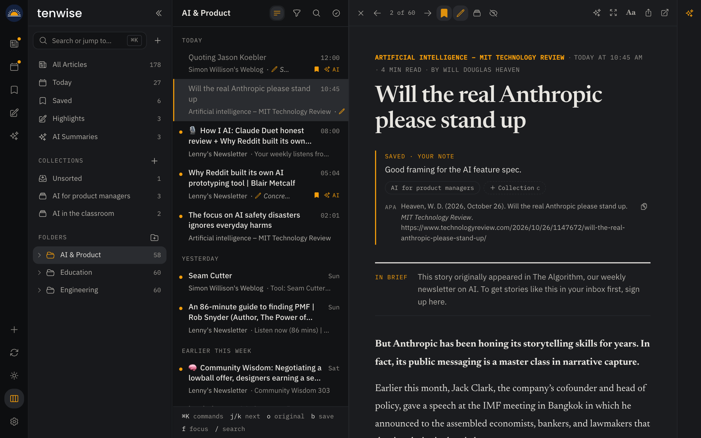
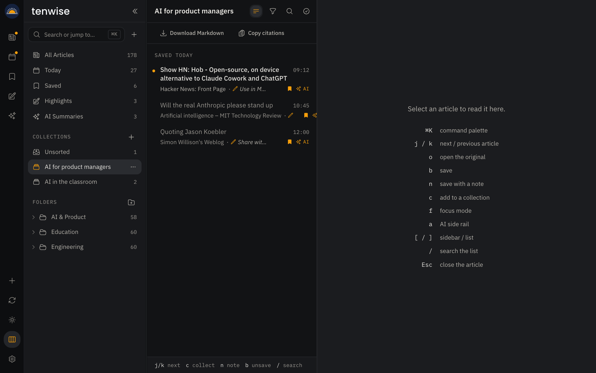
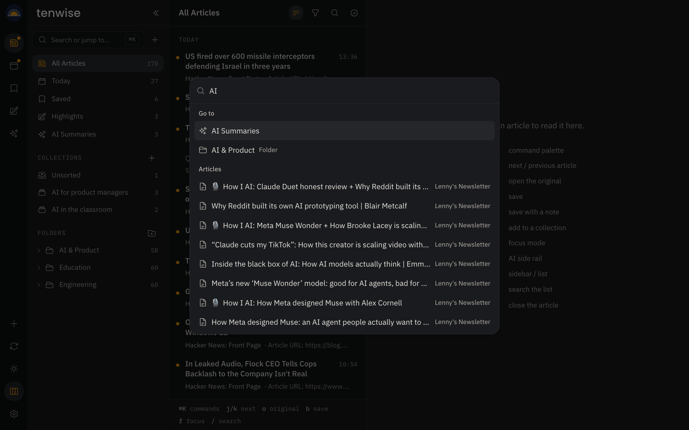
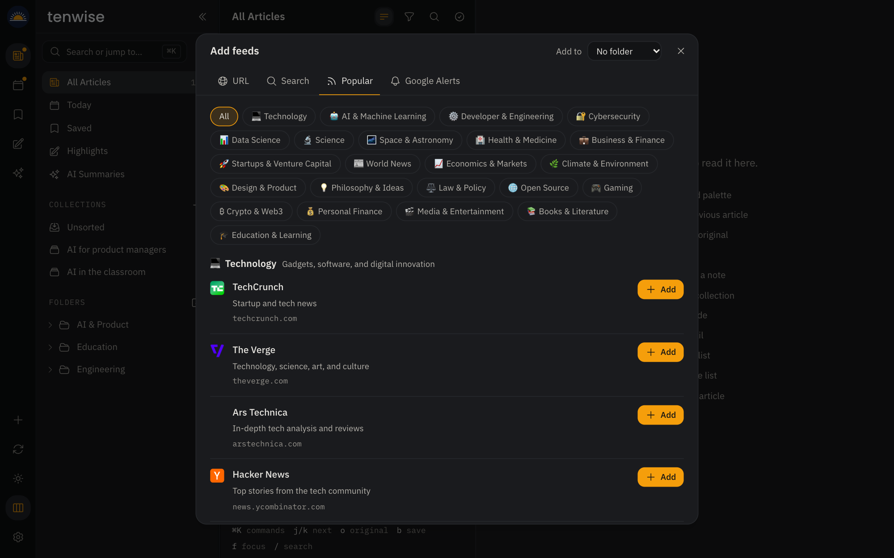
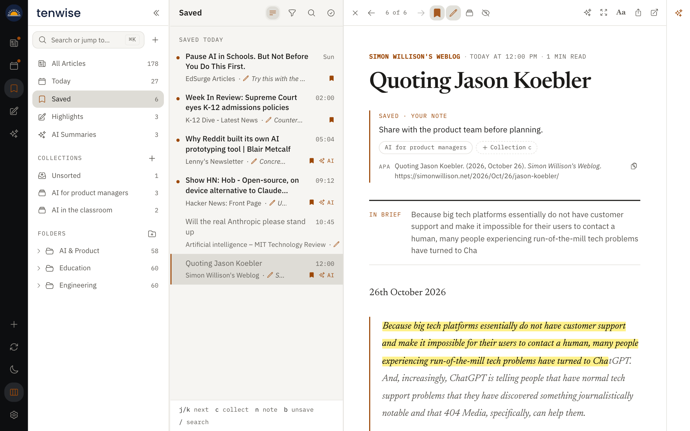
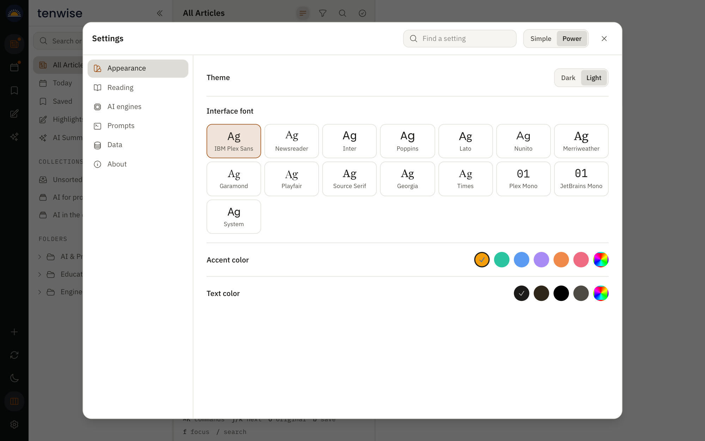

<p align="center">
  <picture>
    <source media="(prefers-color-scheme: dark)" srcset="docs/brand/readme-banner-dark.png">
    
  </picture>
</p>

<p align="center">
  <a href="https://github.com/Tenwise/tenwise-engine/tags"></a>
  <a href="#license"></a>
  
  
  <a href="https://github.com/Tenwise/tenwise-engine/actions/workflows/ci.yml"></a>
  <a href="https://tenwise.app/docs/"></a>
</p>

<p align="center">
  <a href="#quick-start">Quick start</a> ·
  <a href="https://tenwise.app/docs/">User guide</a> ·
  <a href="#the-engine-and-the-tenwise-app">Engine or app?</a> ·
  <a href="https://tenwise.app">tenwise.app</a> ·
  <a href="#license">License</a>
</p>

The Tenwise Engine is a local-first RSS reader for people who read a lot and want to keep what matters. Scan hundreds of articles in dense rows, read in a calm docked reader, save the good ones with a note on why, and file them into collections with ready-made citations.

It runs entirely on your own machine. There is no account, no cloud and no tracking: your feeds, saves and notes live in one local SQLite file. AI summaries and chat run **on-device**, using **Gemini Nano** (built into desktop Google Chrome, no setup) or an optional local **Ollama** model.

The engine is the open-source core of [Tenwise](https://tenwise.app), by CodeStrata, Inc., licensed under the [GNU AGPL v3](#license).



## Why the engine

- **Fast to scan, calm to read.** Dense two-line rows with day headings on the left; a docked reader with good typography on the right. Everything has a key.
- **Built for keeping, not just reading.** Press `b` to save, `n` to save with a note, `c` to file into collections. An Unsorted queue keeps filing quick.
- **Ready to cite.** Every save carries an APA 7 citation, and a collection downloads as one Markdown file of sources.
- **AI that stays home.** Summaries and article chat run on Gemini Nano in your browser or on Ollama on your machine. Article text never goes to a hosted AI service.
- **Yours, on disk.** One SQLite database and one settings file. Copy the folder to back it up.

<table>
  <tr>
    <td width="50%"><p align="center"><em>Dense rows and the docked reader</em></p></td>
    <td width="50%"><p align="center"><em>A collection, ready to cite or download</em></p></td>
  </tr>
  <tr>
    <td width="50%"><p align="center"><em>⌘K: jump anywhere, run any command</em></p></td>
    <td width="50%"><p align="center"><em>Add feeds by URL, search or topic</em></p></td>
  </tr>
  <tr>
    <td width="50%"><p align="center"><em>Light theme</em></p></td>
    <td width="50%"><p align="center"><em>Fonts, accent and text color, your way</em></p></td>
  </tr>
</table>

## The engine and the Tenwise app

The engine is the reading core, free and open source. [Tenwise](https://tenwise.app) is the hosted app built on it, by the same team: sign in with your email, with nothing to install, and your library is there on any browser. The app also has:

- **Google News feeds:** follow a Google News search in any of 23 editions.
- **AI across several articles:** compare sources, write a newsletter, or answer a question from the articles you pick.
- **Analysis and background processing:** sentiment, urgency, tone and topics for each article, summarized automatically as articles arrive, and filters for them.
- **Your voice:** reading personas, a tone and custom instructions for every summary and chat.
- **Studio:** newsletters with designs, exported as Word, PNG or PDF.
- **Send to NotebookLM** from a collection.

The [user guide](https://tenwise.app/docs/) covers both. Features it marks **Tenwise app** are the ones the engine doesn't have.

---

## Quick start

**You need:** Node.js 22.13+ or 24+ (24 LTS recommended; with nvm, run `nvm install` in the folder), and desktop Google Chrome 148+ for the built-in Gemini Nano AI. Ollama is optional.

```bash
git clone https://github.com/Tenwise/tenwise-engine.git
cd tenwise-engine
npm ci
npm run dev
```

Open **http://localhost:5173** in Chrome. `npm run dev` starts the Vite frontend on port 5173 and the Express API on port 3001; Vite proxies `/api/*` to Express. Press `Ctrl + C` to stop. If 3001 is taken, use another port for the API: `PORT=3002 npm run dev`.

To run it without the dev server, `npm start` builds the app and serves everything from **http://localhost:3001** (or your `PORT`).

**On Windows**, commands in this README that set a variable, like `PORT=3002 npm run dev`, are written for macOS and Linux. In PowerShell write `$env:PORT=3002; npm run dev`, and in Command Prompt `set "PORT=3002" && npm run dev`. nvm-windows doesn't read `.nvmrc`, so run `nvm install 24` and `nvm use 24`. The background service below is macOS-only; use `npm start` instead.

Add a feed with **+** in the rail: paste any site URL (the feed is discovered for you), search the curated catalog, pick from the Popular catalog, follow the Google Alerts steps, or import an OPML file in **Settings → Data**.

### Run it like an app (macOS)

Install the engine as a login service so it is always at the same address, without a terminal:

```bash
npm run service install
```

Then open **http://tenwise.localhost:4317**. Chrome resolves every `*.localhost` name to your own machine, so no DNS or hosts-file changes are needed. The service keeps refreshing your feeds while no browser is open, so fast feeds don't lose stories overnight. The app ships a web app manifest and icons, so you can also install it from Chrome's menu to get its own window and dock icon.

| Command | What it does |
|---------|--------------|
| `npm run service install` | Build the app and register the background service |
| `npm run service restart` | Install changed dependencies, rebuild and restart: run this after pulling updates |
| `npm run service status` | Show whether the service is running |
| `npm run service logs` | Follow the logs (`~/Library/Logs/tenwise/`) |
| `npm run service uninstall` | Stop the service and remove it |

The service listens on `127.0.0.1` only and is not reachable from other devices. Set `PORT=<number>` before `install` to use another port. `TENWISE_DATA_DIR` and `OLLAMA_HOST`, if set when you run `install`, are kept for the service too; run `install` again to change them.

---

## Features

### Reading

| Feature | Details |
|---------|---------|
| **Four list views** | **Rows** (default: dense two-line rows with day headings), Grid, List and Compact. Switch in the list header, in **Settings → Reading**, or with ⌘K |
| **Docked reader** | A third pane on wide windows (1100 px and up); on narrower ones it slides over the list. Hide the sidebar with `[` and the list with `]` for more room |
| **Full text, automatically** | The full article is extracted from the source when you open it; the reader shows whether you're reading the full article or the feed's text, and says why when it's the feed's text |
| **Reading comfort** | Newsreader serif by default, with font, size, spacing and width in the **Aa** menu; a progress bar; focus mode (`f`); your scroll position is remembered |
| **In brief** | When an article has an AI summary, it appears at the top of the reader |
| **Highlights** | Select text to highlight it in one of four colours; browse and search them all in **Highlights**, and export as CSV |
| **Command palette** | ⌘K / Ctrl+K: go to any view, folder or feed, run commands (add feed, refresh, theme, panes, list view), or search articles |
| **Share** | LinkedIn, X, email, your system's share sheet, or copy the link |

### Saving and organizing

| Feature | Details |
|---------|---------|
| **Save with a note** | `b` saves an article; `n` saves it and opens a note on why it caught your eye. Saved lists your saves newest first under "today", "yesterday", "this week" and "earlier", with each note in place of the preview |
| **Collections** | `c` opens the collection picker: add the article to one or more collections, or type a name to create one. Adding an article saves it; unsaving removes it from every collection. Rename or delete from the sidebar (deleting a collection keeps its saves) |
| **Unsorted** | Saves that aren't in any collection yet: a filing queue. Press `c` to file one, and `j` moves on to the next |
| **Download a collection** | **Download Markdown** saves a collection's articles as one file (title, source, dates, APA citation, your note and the text of each), ready for any notes or research tool |
| **APA citations** | Every saved article carries an APA 7 citation: under your note in the reader, on each saved summary, and behind a copy button on saved rows (hover). A collection's **Copy citations** copies them all as a reference list, A to Z. Copies paste into a word processor with their italics. arXiv papers are cited as preprints with their arXiv ID; missing authors and dates follow APA's rules |
| **Folders** | Group feeds into folders; right-click a feed to refresh it, move it or remove it |
| **Search** | Full-text search over everything you've fetched, ranked title › source › AI topics › body. Words match as prefixes; "quoted phrases" match exactly. Press `/` |
| **Filters** | The **Filters** button can show only the articles that have an AI summary or analysis |
| **Removing a feed keeps your saves** | Its other articles go, but saved ones stay in Saved and your collections with their notes. Subscribe again and they rejoin the feed |

### AI, on your device

| Feature | Details |
|---------|---------|
| **Gemini Nano by default** | Uses the model built into desktop Google Chrome: no install, no API key, nothing to configure |
| **Ollama, optional** | Connect Ollama for larger local models; a built-in wizard detects it, starts it and pulls models |
| **AI rail** | Press `a` for the side rail: Summary, Chat and Highlights tabs, the model picker, and an "Ask AI about this article" bar |
| **Summaries** | A 3–4 sentence summary of the open article, kept with the article and saved to the **AI Summaries** library when you ask |
| **Editable prompts** | In **Power** mode, **Settings → Prompts** lets you read and change the summary and chat prompts and how much article text they send |

### Feeds

| Feature | Details |
|---------|---------|
| **Add a feed four ways** | Paste a URL (feeds are discovered from the page), search the curated catalog, browse the Popular catalog, or follow the Google Alerts steps |
| **OPML** | Import and export your feeds and folders in **Settings → Data**; imported feeds fetch right away |
| **Feed health** | A feed that fails shows a warning with the reason; refresh it on its own from its menu |
| **Auto-refresh** | Off, 15 min, 30 min, 1 h or 2 h. The local server refreshes on its own, so feeds keep updating with the app closed (not while the computer sleeps). A refresh fetches only what's new |

### Appearance and settings

| Feature | Details |
|---------|---------|
| **Themes** | Dark and light, from the rail, ⌘K or **Settings → Appearance** |
| **Fonts** | 15 self-hosted fonts for the app and the reader, including IBM Plex Sans (default), Newsreader (reader default), Inter, Merriweather, Source Serif and JetBrains Mono |
| **Accent and text colour** | Six accent presets (Amber is the default) or any custom colour; text colour presets for comfort |
| **Simple and Power modes** | Simple shows the settings most people need; Power shows everything, including prompts. Search finds any setting |
| **A settings file** | Settings live in `data/settings.json`: back it up, edit it, or copy it to another machine |

---

## Keyboard shortcuts

| Key | Action |
|-----|--------|
| `⌘K` / `Ctrl+K` | Command palette |
| `/` | Search |
| `[` | Show or hide the sidebar |
| `]` | Show or hide the article list |
| `j` / `↓` / `→` | Next article |
| `k` / `↑` / `←` | Previous article |
| `b` | Save or unsave |
| `n` | Save with a note |
| `c` | Add to collections |
| `o` | Open the original |
| `f` | Focus mode |
| `a` | AI rail |
| `Esc` | Clear the selection or search; in the reader, leave focus mode, then close the article |

The article keys work while an article is open. None of them fire while you're typing. In a note, `Enter` or `Esc` finishes and `Shift+Enter` adds a line.

Without a mouse, `Tab` reaches every article title, sidebar entry, folder toggle and "…" menu, and `Enter` opens it. In a menu, the arrow keys, `Home` and `End` move between items and `Esc` closes it.

---

## Setting up AI

Both engines run on your machine: no API keys, no usage costs, and no article text sent to a hosted AI service.

| | Gemini Nano (default) | Ollama (optional) |
|---|---|---|
| **Setup** | None: built into Google Chrome | Install Ollama and pull a model |
| **Where it runs** | In the browser tab, on your device | In the Ollama service on your machine |
| **Browsers** | Desktop Google Chrome 148+ | Any browser |
| **Models** | Gemini Nano, managed and updated by Chrome | Any model from the Ollama library |
| **Best for** | Summaries and short chats | Longer inputs |

When Gemini Nano is available, the engine uses it automatically. Switch to an Ollama model from the model picker in the AI rail.

### Gemini Nano in Google Chrome (recommended)

1. Open the app in desktop **Google Chrome 148 or later**.
2. Open an article and press `a` (or click the sparkle button in the reader toolbar).
3. Click **Generate summary**. The first time, Chrome downloads Gemini Nano once (a few GB) and reuses it from then on.

**Requirements** (set by Chrome): Windows 10/11, macOS 13+, Linux, or ChromeOS on Chromebook Plus; about 22 GB of free disk space; and either a GPU with more than 4 GB of VRAM or 16 GB of RAM. Check the model's state at `chrome://on-device-internals`.

> **Other browsers.** Plain Chromium, embedded browsers and Chromium-based browsers without Google's model expose the same API but contain no model; the engine detects this and hides Gemini Nano instead of returning placeholder output. Safari and Firefox don't support the API. Use Ollama in those browsers.

**Limits to know**

- **The tab must stay open.** Gemini Nano runs inside the page.
- **No model choice.** Chrome manages the model, and output can change between Chrome versions.
- **Terms.** Gemini Nano is governed by Google Chrome's terms, including Google's [Generative AI Prohibited Use Policy](https://policies.google.com/terms/generative-ai/use-policy).

### Ollama

Open **Settings → AI engines** and click **Set up Ollama**; the wizard checks for Ollama only when you ask, then walks you through download → start → pull a model, and marks the suggested model that suits your computer's memory. Or set it up by hand:

```bash
# Install from https://ollama.com, then pull a model:
ollama pull llama3.2:3b      # fastest; fine with 8 GB of memory
ollama pull gemma3:4b        # balanced; for 16 GB

ollama serve                 # API on http://localhost:11434
```

Installed models appear in the model picker automatically. Models that reason before answering (DeepSeek R1, Qwen 3.5, Gemma 4) work too: the engine asks them for the answer without the reasoning, which keeps summaries fast. If Ollama listens somewhere else (another port, or another machine), set `OLLAMA_HOST` the way Ollama reads it, for example `OLLAMA_HOST=gpu-box:11434 npm run dev`.

---

## Data and privacy

| Data | Where it lives |
|------|----------------|
| Feeds, folders, articles, saves and notes, collections, highlights, AI summaries, search index | `data/reader.db` (one SQLite database) |
| Settings | `data/settings.json` |
| Pane widths, scroll positions and other per-device layout | Your browser's `localStorage` |
| Gemini Nano model | Managed by Google Chrome on your device |

- **Private by design.** Feeds are fetched directly from their publishers; site icons are fetched and cached by your local server, not a third party; AI runs on your device. Nothing is sent to a Tenwise server: the engine doesn't talk to one.
- **Shared across browsers.** Data lives on disk, not in the browser, so every browser on the machine sees the same library.
- **Backup.** Copy the `data/` folder (set `TENWISE_DATA_DIR` to keep it elsewhere). For just your feed list, use **Settings → Data → Export feeds and folders**.

---

## How it works

```
┌──────────────────────── Browser (Chrome) ────────────────────────┐
│                                                                  │
│  Rail + Sidebar   Article list            Reader + AI rail       │
│  views, folders,  Rows · Grid · List ·    In brief, notes,       │
│  collections, ⌘K  Compact (virtualized)   summary and chat       │
│                                                                  │
│  streamChat() ──┬── Gemini Nano (Chrome Prompt API, on-device)   │
│                 └── Ollama (through the local server)            │
└────────────────────────────────┬─────────────────────────────────┘
                                 │  /api/*
┌────────────────────────────────▼─────────────────────────────────┐
│  Express on 127.0.0.1                                            │
│                                                                  │
│  feeds · discover · articles ──► publishers (SSRF-guarded)       │
│  reader · collections ──► data/reader.db (SQLite, FTS5)          │
│  ai · ollama ──► Ollama on :11434 (optional)                     │
└──────────────────────────────────────────────────────────────────┘
```

Browsers block cross-origin requests, so a small local Express server fetches feeds and full articles for the page, checking every user-supplied URL (and every redirect and DNS answer) against SSRF before connecting. It also owns the SQLite database and bridges to Ollama when you use it. Gemini Nano needs no server: it runs inside the page. The server binds to `127.0.0.1` and only admits requests from local origins. [docs/SECURITY-DESIGN.md](docs/SECURITY-DESIGN.md) is the full threat model.

Apps built on the engine add features through its plugin slots: `src/plugins/index.js` in the browser and `server/plugins.js` on the server. A plain engine loads none.

### Technology

| Layer | Technology |
|-------|-----------|
| Frontend | React 19, Vite 8, Tailwind CSS 4, shadcn/ui (Radix, cmdk) |
| Client data | TanStack Query, TanStack Virtual |
| Backend | Express 5, express-rate-limit |
| Storage | SQLite via better-sqlite3, with FTS5 full-text search |
| AI | Gemini Nano (Chrome Prompt API); Ollama, optional |
| Feeds and extraction | rss-parser, @extractus/article-extractor, cheerio, undici |
| Rendering | DOMPurify, marked |
| Fonts | Self-hosted with Fontsource |

### npm scripts

| Command | Description |
|---------|-------------|
| `npm run dev` | Start the frontend (Vite) and backend (Express) together |
| `npm start` | Build the app and serve it, with the API, from one process on port 3001 |
| `npm run dev:frontend` | Start only the Vite frontend |
| `npm run dev:server` | Start only the Express backend |
| `npm run build` | Build the production frontend to `dist/` |
| `npm run preview` | Serve the production build with Vite (start the API too: `npm run dev:server`) |
| `npm test` | Run the test suite (Node's test runner) |
| `npm run service <command>` | Manage the macOS background service (see [Run it like an app](#run-it-like-an-app-macos)) |

---

## Troubleshooting

**"Tenwise needs Node.js …", or `SyntaxError: … does not provide an export named 'styleText'`.** Your Node is too old. Install the current LTS from [nodejs.org](https://nodejs.org) (or `nvm install`), then reinstall the dependencies, which are built for the Node that installed them: `npm ci`.

**`… was compiled against a different Node.js version … NODE_MODULE_VERSION …`.** You changed Node versions after installing. Run `npm ci`. With the background service, run `npm run service install` too, so it uses the new Node.

**"Port 3001 is already in use" or "Port 5173 is already in use".** Another program has the port. See which with `lsof -i :3001` (or `:5173`; on Windows, `netstat -ano | findstr :3001`) and quit it, or give the API another port: `PORT=3002 npm run dev`.

**The app won't load, or it looks empty and adding a feed fails.** The local server isn't running or can't be reached. Check the terminal where you ran `npm run dev` for an error. With the background service, run `npm run service status` and `npm run service logs`. After pulling updates, run `npm run service restart`.

**"No AI model available".** The card says why Gemini Nano isn't available: not Chrome (Chromium, Safari and Firefox don't include it), a Chrome older than 148, or a computer Chrome can't run it on (`chrome://on-device-internals` shows the reason). Or set up Ollama in **Settings → AI engines**.

**"Gemini Nano needs a one-time download".** Chrome hasn't downloaded the model yet, and starts only when you click: use **Download Gemini Nano** in the AI panel or in **Settings → AI engines** to follow its progress. If it never finishes, check that you have about 22 GB free.

**No Ollama models in the picker.** Run `ollama serve`, check `curl http://localhost:11434` (or your `OLLAMA_HOST`), then pull a model (`ollama pull llama3.2:3b`) or use **Pull** in the Ollama setup, which marks the one that suits your computer's memory.

**A feed won't add.** Some sites block automated requests (403/429). Try the feed URL itself, for example `https://feeds.bbci.co.uk/news/rss.xml` instead of `https://bbc.com`.

**The full article doesn't load.** The site blocked extraction. Press `o` to read it on the site.

---

## Contributing and security

[CONTRIBUTING.md](CONTRIBUTING.md) explains how this repository is maintained and how to report bugs. Report security problems privately, as [SECURITY.md](SECURITY.md) describes.

## License

Copyright © 2026 CodeStrata, Inc. The engine's code is free software under the [GNU Affero General Public License, version 3](LICENSE) (AGPL-3.0-only). In plain words:

- **Use it** for yourself, your team or your organization, at no cost.
- **Change it and share it.** What you share, changed or not, stays under the AGPL v3, with its source and this license.
- **Run a changed version for other people over a network,** and you must offer those people its source under the same license.
- **No warranty.** It comes as is.
- **The name and logo aren't included.** "Tenwise" and the Tenwise logo are trademarks of CodeStrata, Inc. A changed version you share or run for others must use its own name and logo. [NOTICE](NOTICE) says so formally.

This summary is a convenience; the [LICENSE](LICENSE) text is what applies.
